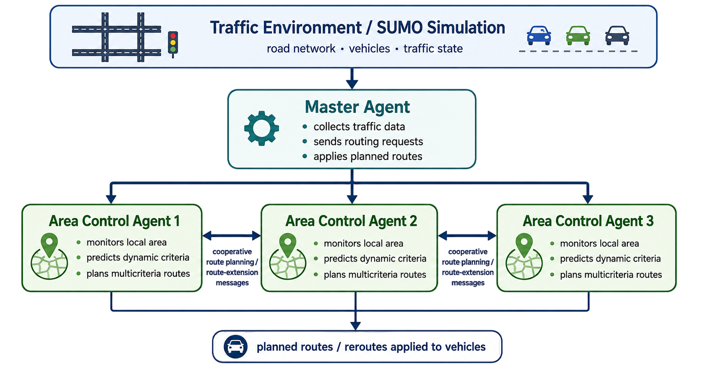

# Cooperative Dynamic Traffic Routing

C++ research software for routing urban traffic with cooperating area-control agents. Each agent plans within its own part of a road network, predicts traffic conditions with XGBoost, and exchanges partial routes with neighboring agents over MPI.

The planner searches for Pareto alternatives across **distance, travel time, fuel consumption, and edge count**, then selects a route using ranked preferences. SUMO provides the traffic simulation through TraCI.

**Paper:** [*Multiagent System for Dynamic Multicriteria Traffic Routing in Urban Environments*](https://dl.acm.org/doi/10.65109/MCOL3382), AAMAS 2026 — Temirlan Kurbanov, Adéla Kubíková, Jiří Vokřínek, and Franziska Klügl. [Citation metadata](CITATION.cff)

## How it works



The master advances SUMO and distributes routing requests and traffic updates to the area agents. Neighboring agents exchange partial routes and planning tokens to extend searches across area boundaries. Once a route is complete, the originating area agent returns it to the master for assignment in SUMO. Every area agent performs its own hierarchical label-setting search and traffic prediction, and records chosen routes to update future traffic expectations. The illustration shows three area agents; the architecture supports additional agents, and the bundled scenario partitions support one to four. Position synchronization runs every 20 seconds in the example; congestion-triggered rerouting is requested every 60 seconds.

## Build and run the xgrid example

Requirements: a C++20 compiler, CMake 3.26 or newer, Python 3.9 or newer, Git, Open MPI, Xerces-C, and zlib. Linux and macOS are the intended environments. Windows support is not configured.

On Ubuntu 24.04:

```bash
sudo apt-get update
sudo apt-get install -y build-essential cmake python3 git libopenmpi-dev openmpi-bin libxerces-c-dev zlib1g-dev
```

On macOS, install the Xcode Command Line Tools and the dependencies:

```bash
brew install cmake open-mpi xerces-c
```

From the repository root:

```bash
python3 scripts/build_dependencies.py --fetch --jobs 4
cmake -S . -B build -C build/deps/paths.cmake \
  -DCMAKE_BUILD_TYPE=Release -DENABLE_SUMO_SMOKE_TEST=ON
cmake --build build --parallel 4
ctest --test-dir build --output-on-failure
python3 scripts/run_example.py
```

The helper uses an existing `../sumo` checkout if it matches the pinned commit, otherwise `--fetch` downloads the pinned fork. It downloads and verifies the **XGBoost 3.0.5** source archive, then builds CPU-only libraries locally under `build/deps/`. It leaves sibling source trees unchanged. Internet access is needed for missing sources; subsequent builds can omit `--fetch`.

The default example uses `scenarios/xgrid`, one area agent plus one master process, and 120 simulation steps. This is a smoke check for startup, model loading, agent communication, and simulation output. It is too short to demonstrate traffic optimization or measure its benefits. Each run writes to a fresh directory under `build/example-output/`:

| File | Contents |
|---|---|
| `run.log` | MPI/application logs and SUMO output |
| `tripinfo.xml` | Completed vehicle-trip statistics |
| `edgedata.xml` | Edge statistics produced by SUMO |
| `vehroutes.xml` | Vehicle routes, including unfinished trips at the stopping point |

The runner checks the process exit status, parses all three XML files, and requires recorded vehicle routes. For a short cooperative smoke check with two area agents:

```bash
python3 scripts/run_example.py --agents 2 --steps 30
```

The current application reserves a 1 GiB MPI send buffer per process. Allow at least 2 GiB plus simulation overhead for the default example, or 3 GiB plus overhead for two area agents. `--timeout` bounds the runner's wall-clock duration.

## Dependency versions

[dependencies.json](dependencies.json) records the SUMO commit, XGBoost release URL and SHA-256 checksum, and model-version metadata.

| Component | Pin / provenance |
|---|---|
| SUMO | [`tem-kurbanov/sumo`](https://github.com/tem-kurbanov/sumo), commit `0814800eceddd60f1fb6b41a7d8ec07589eee7ca` |
| XGBoost inference library | **3.0.5** |
| xgrid models | Model files record XGBoost **3.0.0** |
| InTAS models | Model files record XGBoost **3.0.5** |

XGBoost is pinned to **3.0.5** for the provided models and the original experiment environment. The supplied InTAS models were generated with 3.0.5; the xgrid files record 3.0.0 and are compatible with the pinned library. This pin applies to the bundled model set, not to the routing algorithm itself.

If you train your own models, you can choose whichever XGBoost version you prefer and build against the matching inference library. Keep the expected feature order and output transforms, adapting the estimator integration if your chosen version changes the C API. The setup helper and bundled-model tests remain pinned to 3.0.5; use the manual CMake configuration below for a custom version.

The supplied scenarios use the fork's `time-to-teleport.disable-jam` option. A stock SUMO package may not accept it, so the source helper and CI use the pinned fork.

An existing local XGBoost source tree can be supplied with `--xgboost-source /path/to/xgboost`; it must identify itself as 3.0.5. For a SUMO checkout in another location, use `--sumo-source /path/to/sumo`.

If the dependencies are already built, configure their locations explicitly. For your own models and XGBoost version, disable the bundled test suite with `BUILD_TESTING=OFF`:

```bash
cmake -S . -B build-custom -DCMAKE_BUILD_TYPE=Release -DBUILD_TESTING=OFF \
  -DSUMO_HOME=/path/to/sumo-source \
  -DSUMO_LIBRARY_DIR=/path/to/sumo-library-directory \
  -DXGBOOST_ROOT=/path/to/your-xgboost-source \
  -DXGBOOST_LIBRARY_DIR=/path/to/xgboost-library-directory
cmake --build build-custom --parallel 4
```

Only the TraCI C++ library is needed by this executable; libsumo and GUI bindings are not linked. OpenMP and CUDA are disabled for the helper's XGBoost build. These settings support portable inference and are not a reconstruction of the paper's performance-testing environment.

## Scenarios and direct usage

Both `scenarios/xgrid` and `scenarios/intas` contain network partitions for one to four area agents, SUMO inputs, and pretrained predictors. The executable loads the **`models/log/`** models, whose transforms match the estimator code. The additional xgrid models directly under `models/` are retained as supplied; they are not substituted into the planner.

```text
scenarios/<name>/
  scenario.sumocfg
  graphs/nodes<N>.csv
  graphs/edges<N>.csv
  models/log/{density,speed,fuel}_60.json
  ... network, route and optional additional XML files
```

The graph files use contiguous integer node and edge IDs and cluster-membership bitmasks. Typed route files encode the driver's criterion priorities in the vehicle type ID. The bundled partitions were prepared in advance; graph partitioning and model training are not part of this repository's setup.

For direct use, add the pinned SUMO binary directory to `PATH` and launch exactly one more MPI process than the number of area agents:

```bash
export PATH="$PWD/build/deps/sumo/bin:$PATH"
mpiexec -n 2 build/MASHierarchicalSystem \
  --agents 1 --path "$PWD/scenarios/xgrid" --sync 20 \
  --end 120 --epsilon 0.99 --k 1 --reroute 0.85
```

`--help` lists all options. Direct invocation writes outputs under the scenario directory by default; `--tripinfo`, `--edgedata`, and `--vehroutes` also accept absolute paths to existing output directories. The Python runner handles directory creation and output isolation. Use `--scenario scenarios/intas` with the runner to select InTAS; it is substantially larger and may need a longer timeout.

For Slurm, submit `sbatch submit_jobs.sh` from the repository root after configuring the MPI/SUMO environment. The script defaults to a short xgrid run and two tasks. When overriding `AGENTS`, request `AGENTS + 1` tasks with `sbatch --ntasks=...`.

## Research context and limits

The paper reports experiments on xgrid and InTAS, including improvements in travel time and fuel consumption. Its tables describe the published experiments. This repository includes subsequent fixes and setup improvements; the short checks here do not reproduce those tables, and no new benchmark results are claimed.

This is a research implementation. Further validation is needed for sustained congested operation, current-edge flow accounting during reactive rerouting, and recovery from worker failures. The code supports cooperative planning but does not implement production fault recovery or prove city-scale robustness through these smoke tests.

## Code map

| Files | Responsibility |
|---|---|
| `main.cpp` | CLI, master/worker startup, SUMO interface and synchronization |
| `Router.cpp`, `Router.h` | Cooperative search, route choice, prediction records and rerouting |
| `CoverGraph.*`, `CoverEdge.*` | Hierarchical path-cover construction and traversal |
| `Graph.h`, `Node.h`, `Edge.h` | Network representation |
| `*Estimator.*` | XGBoost predictors and output transforms |
| `serializations.h` | MPI message tags and data structures |
| `scripts/`, `tests/` | Setup, bounded example runner and verification |

## Authorship and AI assistance

The research, architecture, algorithms, and original implementation were developed without AI assistance. AI tools were used subsequently for repository presentation and documentation, along with supporting build, test, and CI tooling.

## Citation and licensing

This project uses [Eclipse SUMO](https://github.com/eclipse-sumo/sumo). Following its [recommended citation](https://github.com/eclipse-sumo/sumo/blob/main/CITATION.cff):

Pablo Alvarez Lopez et al. [*Microscopic Traffic Simulation using SUMO*](https://doi.org/10.1109/ITSC.2018.8569938). In *2018 21st International Conference on Intelligent Transportation Systems (ITSC)*, pp. 2575–2582. IEEE, 2018.

The project's own code, documentation, xgrid assets, and pretrained models are licensed under the [MIT License](LICENSE). The adapted InTAS scenario retains its GPL terms, and external dependencies retain their own notices. See [THIRD_PARTY.md](THIRD_PARTY.md) for scope and provenance, and [CITATION.cff](CITATION.cff) for the paper citation.
